# 🏢 Claude Office

Một văn phòng pixel 2D để chạy và theo dõi Claude Code. Mỗi session là một phòng, trong phòng có nhân vật Claude
làm đúng việc Claude đang làm, có bạn ngồi bàn riêng kèm pet, và có sub-agent ra vào khi Claude giao việc.
Terminal Claude Code thật nằm ngay trong app, nên dùng được để thay Warp hay iTerm. Người cùng mạng công ty có
thể vào chung một team để thấy nhau đang làm gì và nhắn tin cho nhau.

Chạy trên **macOS** (chip Apple và Intel), **Windows** và **Linux**.

Repo này chỉ chứa các bản phát hành. **Tải bản mới nhất ở [Releases](https://github.com/DinhVietKhoi/claud-office-app/releases/latest).**

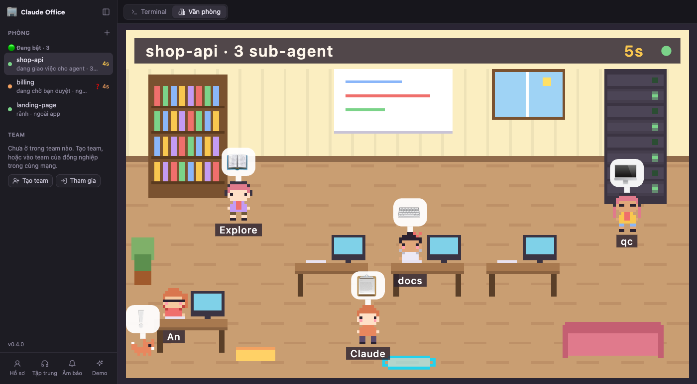

**Mục lục**

- [Có gì](#có-gì)
- [Hướng dẫn sử dụng](#hướng-dẫn-sử-dụng)
  - [Màn hình chính](#1-màn-hình-chính)
  - [Mở phòng và làm việc trong terminal](#2-mở-phòng-và-làm-việc-trong-terminal)
  - [Xem văn phòng](#3-xem-văn-phòng)
  - [Sub-agent](#4-sub-agent)
  - [Khi Claude cần bạn duyệt](#5-khi-claude-cần-bạn-duyệt)
  - [Nhân vật và pet](#6-nhân-vật-và-pet)
  - [Team](#7-team)
  - [Phím tắt](#8-phím-tắt)
- [Cài đặt và thiết lập](#cài-đặt-và-thiết-lập)
- [Hỏi nhanh](#hỏi-nhanh)

## Có gì

- **Terminal thật bên trong app:** mỗi phòng chạy `claude` trong một PTY riêng. Slash command, duyệt quyền, hook
  và config trong `~/.claude` vẫn y như khi chạy ngoài.
- **Văn phòng theo dõi từng phòng:** Claude đọc code thì đứng ở kệ sách, sửa file thì gõ phím ở bàn, chạy lệnh
  thì đứng ở server rack, rảnh thì ngồi sofa uống cà phê. Gọi sub-agent thì từng sub-agent bước ra từ cổng dịch
  chuyển và làm việc riêng của nó.
- **Không bỏ lỡ lúc Claude cần bạn:** Claude chạy tới bàn bạn giơ ❓, có tiếng báo, thông báo desktop, tiêu đề
  cửa sổ đếm số phòng đang chờ, pet chạy tới báo nếu bạn đang xem phòng khác.
- **Nhân vật và pet của riêng bạn**, đồng nghiệp trong team thấy đúng nhân vật đó.
- **Team trong mạng LAN:** phòng chung của cả team, gõ cửa 👋, nhắn tin, xem mức dùng Claude 5h / 7d của nhau.
- **Session mở ở terminal khác** (Warp, iTerm, VS Code…) cũng hiện thành phòng để theo dõi.
- **Tự cập nhật** và **Demo** 30 giây không tốn token để giới thiệu cho người khác.

## Hướng dẫn sử dụng

### 1. Màn hình chính

App có hai chế độ, chuyển bằng công tắc ở góc trên bên trái hoặc phím `Ctrl+\``:

- **Terminal:** terminal Claude Code của phòng đang chọn chiếm trọn màn hình, dùng để làm việc.
- **Văn phòng:** vẽ phòng đang chọn thành một căn phòng pixel, dùng để nhìn xem Claude và sub-agent đang làm gì.

Thanh bên trái luôn hiện:

| Mục | Ý nghĩa |
|---|---|
| **👥 Phòng team** | Chỉ có khi bạn đang ở trong team. Bấm để xem cả team trong một phòng chung |
| **🟢 Đang bật** | Các phòng có session Claude đang chạy. Dòng phụ ghi Claude đang làm gì, số sub-agent; bên phải là thời gian đã chạy và ❓ nếu đang chờ bạn duyệt |
| **⚫ Đã tắt** | Phòng đã tắt, bấm vào rồi bấm **Mở lại** để resume đúng session cũ |
| **Team** | Tên team, từng người kèm trạng thái và mức dùng 5h / 7d, mục **# Cả team** để chat nhóm |
| Góc dưới | **Hồ sơ** (tên, nhân vật, kết nối), **Tập trung**, **Âm báo**, **Demo**, số phiên bản (bấm để kiểm tra bản mới) |

Cửa sổ hẹp (dưới khoảng 760px) thì thanh bên tự thu gọn và công tắc chỉ còn icon. Bấm nút thanh bên ở góc trên
bên trái để mở nó ra dạng nổi, bấm ra ngoài là nó tự đóng.

### 2. Mở phòng và làm việc trong terminal

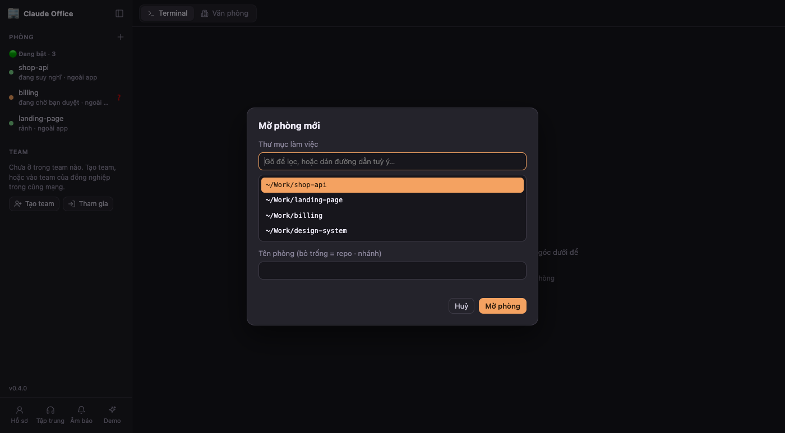

1. Bấm **＋** ở mục Phòng. App gợi ý các thư mục bạn hay chạy Claude gần đây, gõ để lọc hoặc dán đường dẫn bất
   kỳ.
2. Đặt tên phòng nếu muốn (bỏ trống thì lấy tên repo và nhánh), bấm **Mở phòng**.
3. Terminal mở ra với `claude` đang chạy. Dùng y như terminal thường, kể cả dán ảnh bằng `Cmd+V` / `Ctrl+V`.

Trên thanh trên cùng của phòng:

- **Double-click tên phòng** để đổi tên.
- **Tắt** dừng session, **Mở lại** resume đúng session đó (kể cả sau khi bạn `/clear`), **🗑** xoá phòng khỏi
  danh sách.
- **Nút con mắt** (khi đang ở trong team) cho team thấy tên phòng này. Mặc định team chỉ thấy bạn đang làm hay
  rảnh.

Session bạn mở ở terminal khác cũng tự hiện thành phòng ("ngoài app"). Muốn chuyển nó vào app thì tắt bên kia
rồi bấm **Mở lại**.

### 3. Xem văn phòng

Chuyển sang **Văn phòng** rồi bấm phòng nào ở thanh bên thì văn phòng đổi sang phòng đó, vẫn ở chế độ Văn phòng.
Thanh tiêu đề trong cảnh ghi tên phòng, số sub-agent, thời gian chạy và chấm trạng thái.

| Bạn thấy | Nghĩa là |
|---|---|
| Claude đứng ở **kệ sách** 📖 | Đang đọc code (Read, Grep, Glob, WebFetch…) |
| Claude **gõ phím ở bàn** ⌨️ / 🤔 | Đang sửa file (Edit, Write) hoặc đang nghĩ |
| Claude đứng ở **server rack** 🖥️ | Đang chạy lệnh, xong thì hiện ✅ hoặc ❌ |
| Claude đứng gần **cổng dịch chuyển** 📋 | Đang giao việc cho sub-agent |
| Claude **ngồi sofa uống cà phê** ☕ | Rảnh, chờ bạn gõ tiếp |
| Claude ngủ gà gật, phòng tối | Phòng đã tắt |
| **Bạn** đi tới chỗ Claude cầm 📝 | Bạn vừa gửi prompt |
| Claude 🎉 / ✅, bạn 🙌 | Xong một lượt. Task dài trên 30 giây thì bắn confetti |

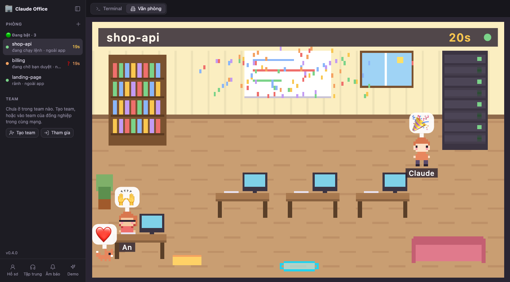

Claude đổi chỗ bằng cách dịch chuyển "poof" chứ không chạy lòng vòng, và đứng yên ít nhất 1,5 giây ở mỗi chỗ để
mắt kịp theo.

- **Rê chuột vào Claude:** xem thư mục, việc đang làm, tool đang chạy, prompt gần nhất.
- **Bấm vào Claude:** nhảy sang terminal của phòng đó.

### 4. Sub-agent

Khi Claude gọi sub-agent (tool Agent / Task), mỗi sub-agent là một nhân vật riêng:

1. Sub-agent bước ra từ cổng dịch chuyển, Claude đưa giấy giao việc 📝.
2. Sub-agent làm việc theo đúng tool của nó: đọc code ở kệ sách, sửa file ở bàn trống, chạy lệnh ở server rack,
   suy nghĩ ở bảng trắng. Tool của sub-agent không làm Claude chính đổi động tác.
3. Xong việc, sub-agent mang 📄 kết quả về đưa Claude rồi đi ra cổng.

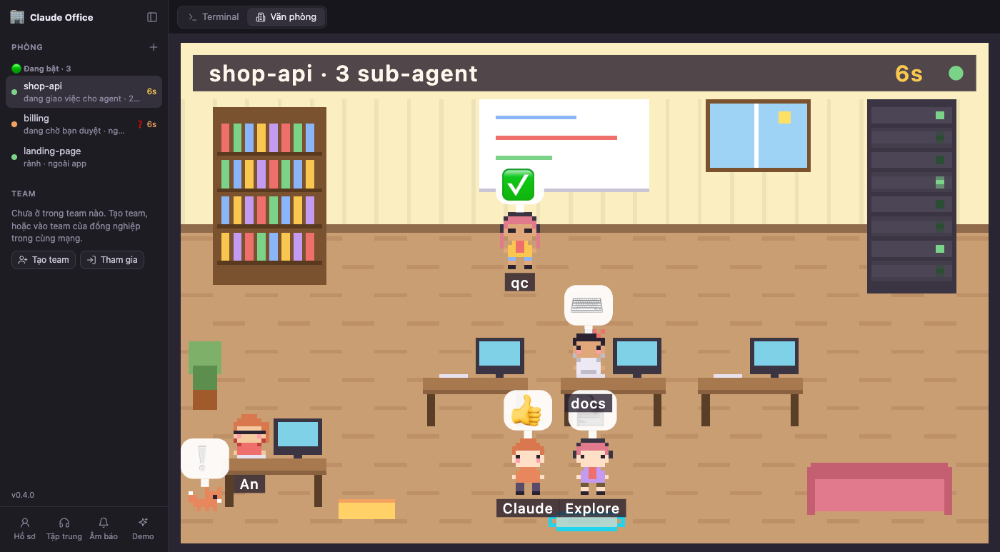

Rê chuột vào sub-agent để xem loại, việc đang làm và đã chạy bao lâu. Sub-agent chạy nền vẫn ở trong phòng kể cả
khi Claude chính đã xong lượt.

### 5. Khi Claude cần bạn duyệt

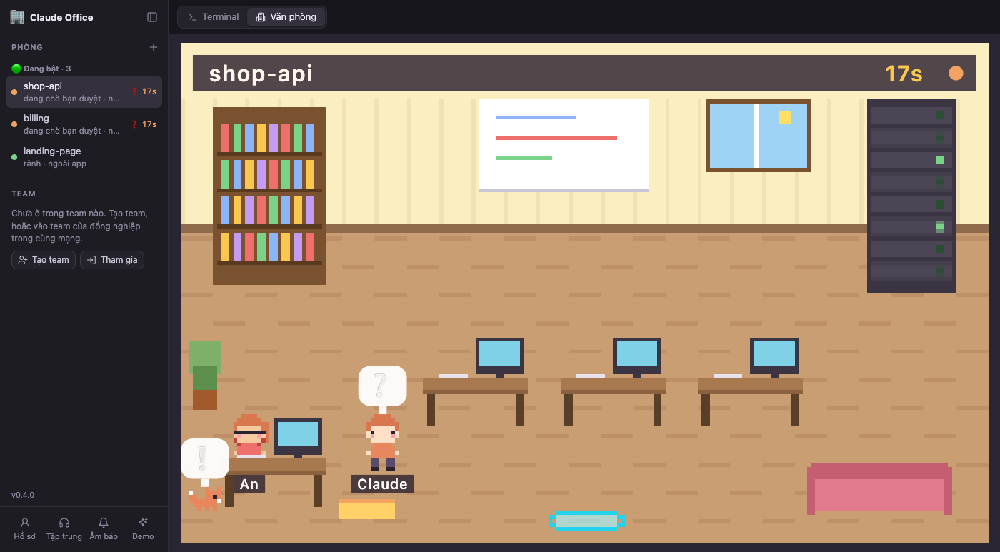

- Claude dịch chuyển tới cạnh bàn bạn giơ ❓, bạn nhìn sang 👀.
- Có tiếng báo và thông báo desktop. Bấm thông báo là nhảy thẳng vào terminal của phòng đó.
- Tiêu đề cửa sổ hiện `(2 ❓)` theo số phòng đang chờ, thanh bên có ❓ cạnh phòng đó.
- Đang xem phòng khác thì **pet** chạy tới góc bàn bạn giơ ❗. Bấm vào pet là văn phòng chuyển sang phòng đang
  chờ.

### 6. Nhân vật và pet

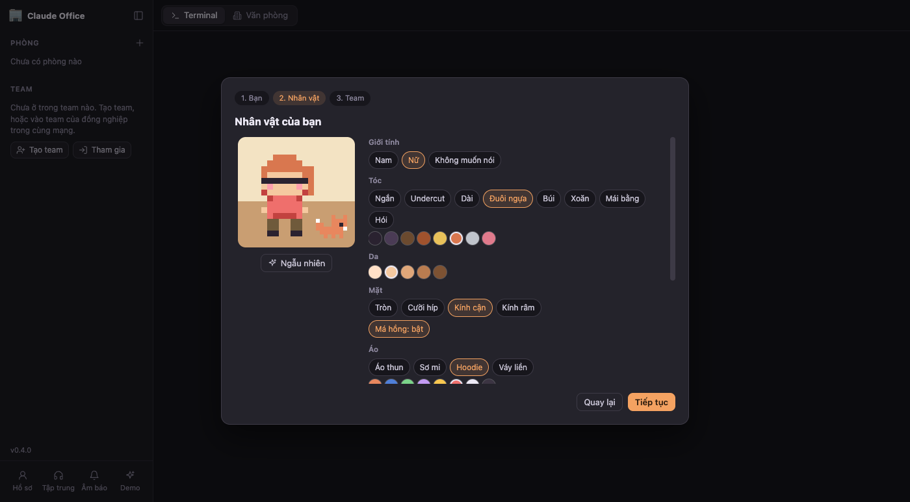

Chọn ở bước 2 của màn thiết lập hoặc **Hồ sơ → Nhân vật**: giới tính (chỉ để gợi ý bộ đồ ban đầu), kiểu tóc và
màu tóc, màu da, mắt (tròn, cười híp, kính cận, kính râm), má hồng, áo, quần, phụ kiện, hoặc bấm **Ngẫu nhiên**.
Chọn thêm một pet (mèo, chó, cáo, hamster, cánh cụt), màu và tên.

Pet sống cạnh bàn bạn và có việc để làm:

- **Canh phòng chờ duyệt:** giơ ❗ khi phòng khác cần bạn, bấm vào là chuyển sang phòng đó.
- **Nhắc nghỉ:** làm liên tục 50 phút thì mang nước 💧 tới kèm lời nhắc. Tắt được trong Hồ sơ.
- **Giữ thư lúc tập trung:** có tin nhắn khi bạn đang Tập trung thì ôm ✉️ kèm số tin, tắt Tập trung là mang thư
  tới.
- **Cảm xúc:** task dài xong thì ❤️, lệnh lỗi thì 🙈, mọi phòng rảnh lâu thì cuộn tròn ngủ trên đệm.
- **Vuốt ve:** bấm vào pet để xem nhanh bao nhiêu phòng đang mở, đang làm, đang chờ duyệt.

### 7. Team

**Tạo hoặc vào team**

1. Một người bấm **Tạo team**, đặt tên và chọn:
   - **Public** 🌐: ai cùng mạng cũng vào được ngay;
   - **Private** 🔒: người xin vào phải được chủ phòng hoặc phó phòng duyệt.
2. Người cùng mạng bấm **Tham gia**: app liệt kê các team đang có trong mạng (tên, chủ phòng, số người). Bấm
   **Vào** (public) hoặc **Xin vào** (private). Có **mã mời** kiểu `K7Q-2MX` thì nhập mã là vào thẳng, không cần
   duyệt. Mạng công ty chặn gói tin tìm máy thì gửi **link mời** và dán link thay cho mã.
3. Người xin vào team private làm chủ phòng thấy banner **Cho vào / Từ chối**.

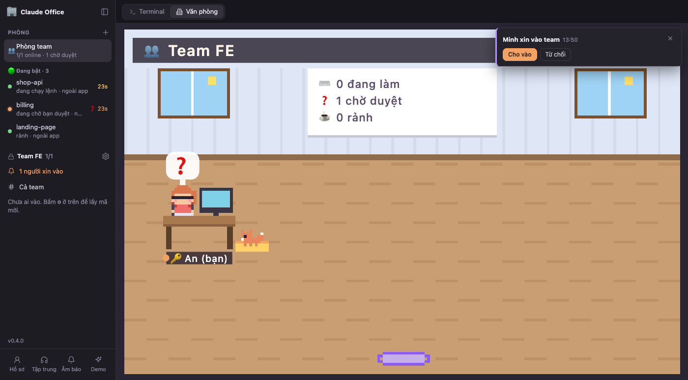

**Phòng team**

Bấm **👥 Phòng team** ở đầu danh sách phòng. Mỗi người một bàn kèm pet, tên, chấm trạng thái và hai vạch 5h / 7d.
Bảng trắng đếm bao nhiêu người đang làm, chờ duyệt, rảnh.

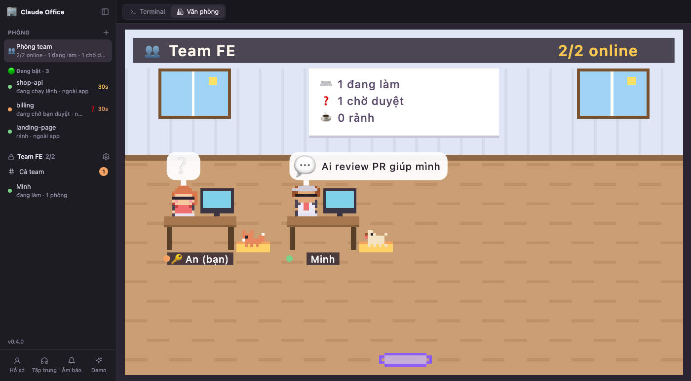

| Bạn thấy | Nghĩa là |
|---|---|
| Gõ phím | Đang làm |
| ☕ | Rảnh |
| ❓ | Đang có phòng chờ duyệt |
| Đeo tai nghe 🔕 | Đang Tập trung, đừng làm phiền |
| Ghế trống, màn hình tắt | Offline |
| Bong bóng 💬 có nội dung | Người đó vừa nhắn tin |
| Người đó đi tới bàn bạn 👋 | Họ gõ cửa bạn |
| Một người ✅, cả phòng 👏 | Người đó vừa xong task |
| Người mới bước ra từ cổng, cả phòng 👋 | Có người vừa vào team |

Rê chuột vào một người để xem trạng thái và phòng họ đang làm (nếu họ chia sẻ). Bấm vào người đó để mở chat
riêng, bấm vào chính mình để mở chat cả team.

**Gõ cửa và nhắn tin**

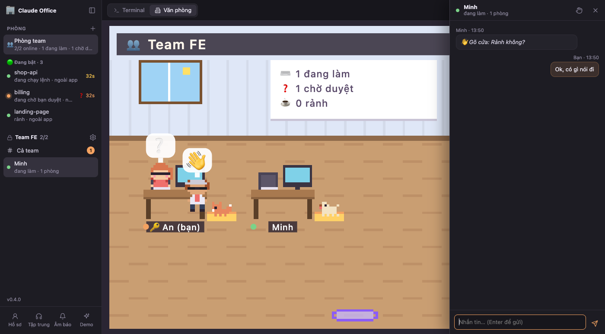

- **Gõ cửa 👋** (rê chuột vào tên người ở thanh bên): hỏi nhanh "Rảnh không?". Bên kia trả lời bằng một chạm:
  "Rảnh, nói đi", "5 phút nữa nhé", "Đang tập trung, nhắn sau".
- **Nhắn tin:** bấm tên một người để chat riêng, hoặc **# Cả team** để nhắn cả nhóm. Tin mới hiện banner góc
  phải, có tiếng báo và badge đếm tin chưa đọc. Trong văn phòng, nhân vật người gửi bước ra từ cổng ghé bàn
  bạn (gõ cửa thì pet của họ đi theo); ở phòng team thì họ hiện bong bóng chat hoặc đi tới bàn bạn.
- **Tập trung:** tắt banner và âm báo tin nhắn, team thấy bạn đeo tai nghe. Tắt chế độ này thì app nhắc lại
  những tin bạn đã lỡ.
- **5h / 7d:** chỉ cập nhật khi người đó đang mở Claude Code (lấy từ statusline). Tắt chia sẻ ở **Hồ sơ**.

**Vai trò**

| Vai | Quyền |
|---|---|
| 🔑 vàng **Chủ phòng** (người tạo team) | Duyệt người vào, mời ra, phong / gỡ phó phòng, đổi tên team, đổi public / private, đổi mã mời, giải tán |
| 🔑 bạc **Phó phòng** | Duyệt người vào, mời thành viên thường ra, đổi mã mời |
| Thành viên | Trò chuyện, gõ cửa, xem trạng thái |

Chủ phòng chuột phải (hoặc bấm ⋯) vào tên một người để phong phó phòng hay mời ra. Bấm tên team ở thanh bên để
xem cài đặt, mã mời và danh sách người đang xin vào.

**An toàn**

- Tin nhắn chỉ hiện cho người, **không bao giờ đi vào Claude**, nên đồng nghiệp không thể khiến Claude trên máy
  bạn chạy lệnh.
- Không ai xem hay gõ được vào terminal của người khác. Team chỉ truyền tên, nhân vật, trạng thái, % mức dùng
  5h / 7d (nếu bật) và tin nhắn, không có prompt, đường dẫn, email hay code.
- Server chính chỉ nghe ở `127.0.0.1`. Riêng máy của người mời mở thêm cổng team (TCP 4787) và cổng tìm máy
  (UDP 4786) trong mạng LAN, mọi request vào cổng team đều phải có mã hoặc token. Lần đầu mở, macOS hoặc Windows
  Firewall sẽ hỏi cho phép kết nối, chọn Cho phép (mạng riêng).
- Máy người mời làm "hub": máy đó tắt thì team tạm mất kết nối, bật lại thì mọi người tự nối lại. Mọi tin
  nhắn, kể cả tin nhắn riêng giữa hai người khác, được lưu dạng chữ thường trên ổ đĩa máy hub (`team.json`
  trong thư mục dữ liệu). Chủ máy hub không thấy tin riêng của người khác trong app, nhưng file thì vẫn nằm trên
  máy họ, nên đừng gửi mật khẩu hay thông tin nhạy cảm qua đây.

### 8. Phím tắt

| Lệnh / phím | Tác dụng |
|---|---|
| `claude office` hoặc `office` | Bật server (nếu chưa chạy) và mở cửa sổ app |
| `office stop` | Tắt server. Lần sau mở lại, các phòng đang chạy tự mở lại đúng session |
| `Ctrl+\`` | Chuyển qua lại Terminal / Văn phòng |
| `Ctrl+1..9` | Chuyển nhanh giữa các phòng (giữ nguyên chế độ đang xem) |
| `Cmd+V` / `Ctrl+V` khi clipboard có ảnh | Dán ảnh cho Claude |
| Double-click tên phòng trên thanh trên cùng | Đổi tên phòng |
| **Demo** ở góc dưới | Mở một phòng giả chạy kịch bản 30 giây: đọc code, sửa file, gọi 2 sub-agent, chờ duyệt, ăn mừng |

## Cài đặt và thiết lập

### Tải và cài

Máy cần có sẵn **Claude Code** (lệnh `claude`). App đã gói kèm Node bên trong, không cần cài gì thêm. Nên có
Chrome hoặc Edge để app mở thành cửa sổ riêng; không có thì app mở trong trình duyệt mặc định.

Tải bản mới nhất ở **[Releases](https://github.com/DinhVietKhoi/claud-office-app/releases/latest)**:

| Máy | File |
|---|---|
| Mac chip Apple (M1 trở lên) | `Claude-Office-<version>-mac-arm64.zip` |
| Mac Intel | `Claude-Office-<version>-mac-x64.zip` |
| Windows | `Claude-Office-<version>-win-x64.zip` |
| Linux | `Claude-Office-<version>-linux-x64.tar.gz` |

**macOS**

1. Giải nén, kéo `Claude Office.app` vào thư mục **Applications**. Đừng mở thẳng trong Downloads: macOS sẽ chạy
   app từ thư mục tạm và app không kết nối được Claude Code.
2. App chưa được Apple ký nên lần đầu macOS sẽ chặn. Mở **System Settings → Privacy & Security**, kéo xuống
   bấm **Open Anyway**. Hoặc chạy một lệnh trong Terminal:
   `xattr -dr com.apple.quarantine "/Applications/Claude Office.app"`
3. Mở app từ Launchpad hoặc Applications.

**Windows**

1. Chuột phải vào file zip → **Properties** → tick **Unblock** → OK, rồi giải nén vào chỗ cố định, ví dụ
   `C:\Users\<bạn>\AppData\Local\Claude Office`.
2. Nhấp đúp `Claude Office.vbs`. Nếu Windows hiện cảnh báo SmartScreen thì bấm **More info → Run anyway**.

**Linux**

```bash
mkdir -p ~/.local/opt && tar -xzf Claude-Office-*-linux-x64.tar.gz -C ~/.local/opt
~/.local/opt/claude-office/claude-office
```

### Thiết lập lần đầu

Lần đầu mở app có màn thiết lập 3 bước.

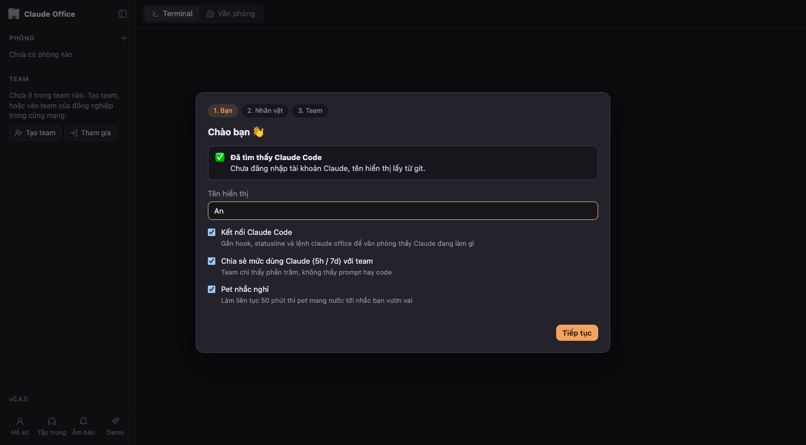

**Bước 1 · Bạn.** App tự dò Claude Code và tài khoản Claude, điền sẵn **tên hiển thị** (sửa được). Email và tổ
chức chỉ hiện trên máy bạn, không gửi cho team. Có 3 lựa chọn:

- **Kết nối Claude Code** (nên bật). App sẽ:
  - gắn hook vào `~/.claude/settings.json` để văn phòng thấy Claude đang làm gì. Hook có sẵn của bạn được giữ
    nguyên, bản cũ lưu ở `~/.claude/settings.json.bak-claude-office`;
  - bọc statusline hiện có để lấy mức dùng 5h / 7d (statusline vẫn hiện y như cũ, gỡ app thì trả lại);
  - thêm lệnh `claude office` vào terminal (zsh/bash, hoặc PowerShell trên Windows);
  - tạo lối tắt trong Start Menu (Windows) hoặc menu ứng dụng (Linux).
- **Chia sẻ mức dùng Claude (5h / 7d) với team:** team chỉ thấy phần trăm.
- **Pet nhắc nghỉ** sau 50 phút làm liên tục.

**Bước 2 · Nhân vật.** Chọn nhân vật và pet như ở mục [Nhân vật và pet](#6-nhân-vật-và-pet).

**Bước 3 · Team.** Tạo team, tham gia team, hoặc để sau.

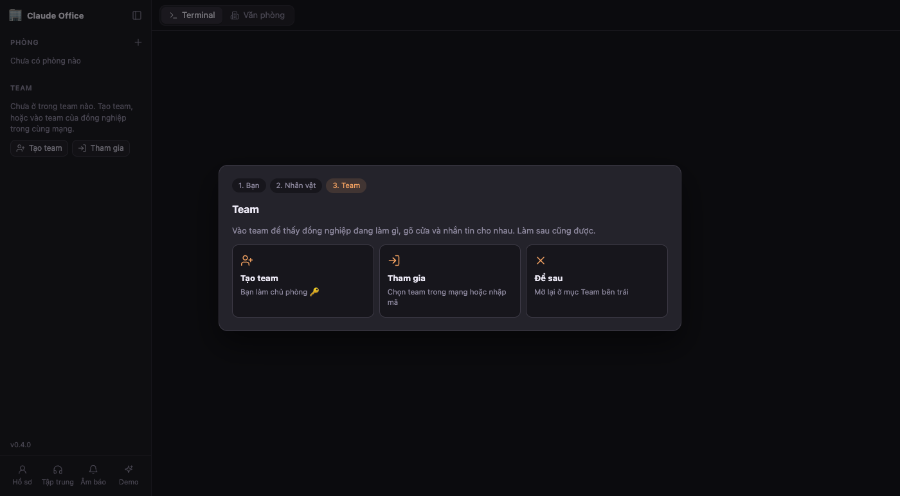

Mọi thứ sửa lại được bất cứ lúc nào ở nút **Hồ sơ** góc dưới thanh bên (tab Thông tin và Nhân vật). Lúc đầu bỏ
tick Kết nối thì app hiện dải nhắc **Kết nối với Claude Code** ở trên cùng, bấm **Kết nối** là xong.

**Chưa cài Claude Code** vẫn dùng được: vào team, trò chuyện, gõ cửa. Chỉ có nút mở phòng Claude bị khoá. Cài
Claude Code xong thì mở lại app và bấm **Hồ sơ → Kết nối**.

### Kiểm tra đã kết nối đúng chưa

1. Mở một terminal bất kỳ (ngoài app), chạy `claude` trong một repo và gõ một prompt.
2. Trong app, thanh bên phải hiện một phòng mới "ngoài app" đang làm việc.
3. Chuyển sang Văn phòng, bấm phòng đó: Claude phải đổi chỗ theo tool đang chạy.

Không thấy phòng thì mở **Hồ sơ**, xem dòng Kết nối có báo "Đã kết nối" chưa. Đã kết nối mà vẫn không thấy thì
thoát session Claude đó và mở lại.

### Cập nhật

App tự kiểm tra bản mới khi mở và cứ vài tiếng một lần. Có bản mới thì thanh bên hiện nút **Có bản mới vX**.
Bấm vào để đọc thay đổi, rồi bấm **Cập nhật và khởi động lại**. App tự tải, kiểm tra checksum, thay app cũ và
khởi động lại. Các phòng đang chạy tự mở lại đúng session, riêng lượt Claude đang làm dở thì bị ngắt, bạn gõ
"tiếp tục" là được. Nếu bản mới không khởi động được, app tự quay về bản cũ.

Muốn kiểm tra ngay thì bấm vào số phiên bản ở góc dưới thanh bên.

### Gỡ

Chạy `office stop`, gỡ hook, statusline và lệnh `claude office` bằng
`"<thư mục app>/node" "<thư mục app>/app/bin/setup.mjs" --uninstall` (Windows là `node.exe`), rồi xoá thư mục
app. Trên Mac, `<thư mục app>` là `/Applications/Claude Office.app/Contents/Resources`.

## Hỏi nhanh

**Hook có làm Claude chậm đi không?** Trên Mac và Linux mỗi sự kiện tốn khoảng 10ms (`curl` chạy nền, timeout
1 giây). Trên Windows hook chạy bằng Node nên chậm hơn một chút. Không mở app thì hook thất bại im lặng, Claude
vẫn chạy như thường.

**Tắt cửa sổ app thì session có tắt không?** Không. Session chạy trong server, đóng cửa sổ rồi mở lại vẫn
thấy nguyên. Chỉ `office stop` mới tắt session, và lần bật sau chúng tự resume.

**Gõ `/clear` trong một phòng thì sao?** Claude đổi session ID nhưng phòng vẫn giữ nguyên. "Mở lại" luôn
resume session mới nhất của phòng.

**Dữ liệu lưu ở đâu?** Mac: `~/Library/Application Support/Claude Office`. Windows: `%APPDATA%\Claude Office`.
Linux: `~/.local/share/claude-office`. Log server là `server.log`
trong cùng thư mục.

**Đổi tên hiển thị?** Bấm **Hồ sơ** ở góc dưới thanh bên, sửa tên rồi Lưu. Lần đầu mở app, tên được điền sẵn từ
tài khoản Claude hoặc `git config user.name`.
